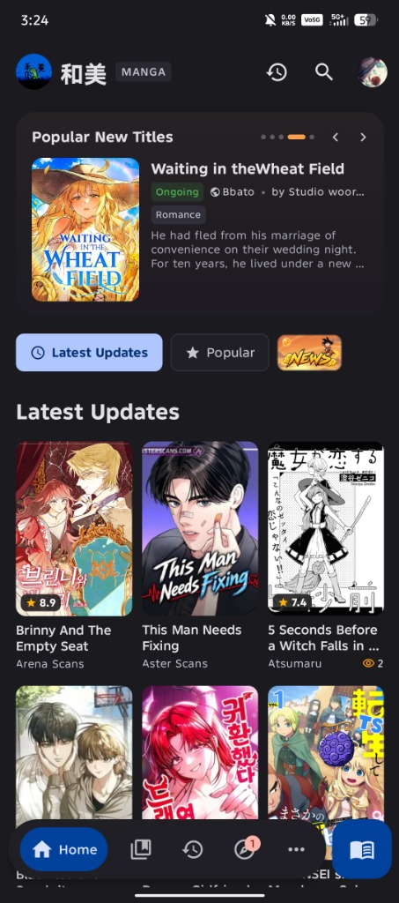
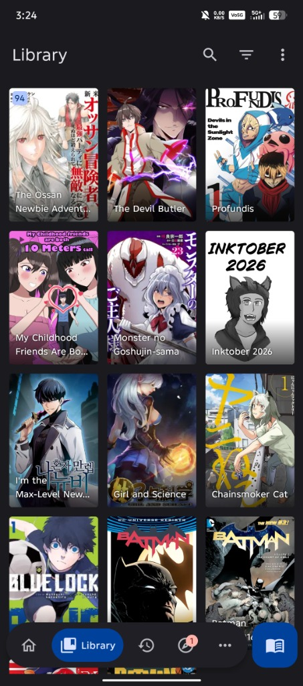
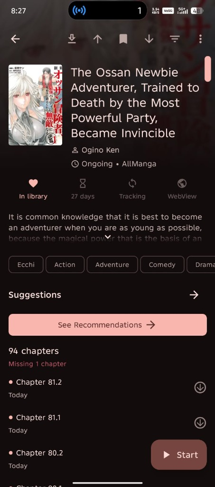
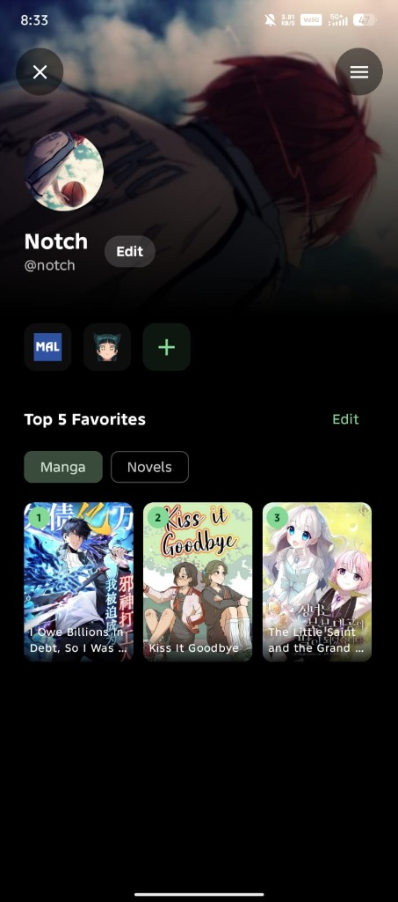

<p align="center">
  
</p>

<h1 align="center">Wammy</h1>

<p align="center">
  A modern, high-performance, open-source manga, manhwa, and light novel reader for Android with a clean Material 3 design. Built with Jetpack Compose, featuring native built-in sources, Mihon APK extensions, and LNReader plugin support.
</p>

<p align="center">
  <a href="https://github.com/kainotch/Wammy/releases/latest"></a>
  <a href="https://discord.com/invite/qybFSATs7Q"></a>
  <a href="https://github.com/kainotch/Wammy/releases"></a>
  <a href="LICENSE"></a>
</p>

<p align="center">
  <a href="https://developer.android.com/"></a>
  <a href="https://kotlinlang.org/"></a>
  <a href="https://developer.android.com/compose"></a>
  <a href="https://m3.material.io/"></a>
</p>

<p align="center">
  <a href="https://github.com/kainotch/Wammy/releases/latest"><strong>Download APK</strong></a>
  |
  <a href="https://kainotch.github.io/WammyWeb/"><strong>Website</strong></a>
  |
  <a href="https://discord.com/invite/qybFSATs7Q"><strong>Discord</strong></a>
  |
  <a href="https://github.com/kainotch/Wammy/issues"><strong>Issues</strong></a>
</p>

---

## About

Wammy is a free and open-source Android application that unifies manga, manhwa, manhua, and light novels into a single, blazing-fast, and customizable reading experience. Built from the ground up with Jetpack Compose and modern Android architecture.

If you enjoy using Wammy, please consider starring the repository — it helps more readers discover the project!

---

## Screenshots

<p align="center">
  
  
  
  
</p>

<p align="center">
  <sub><b>Home & Discover</b> (Hero Featured Carousel & Badges) | <b>Library</b> (Comfortable/Compact Grid) | <b>Details & Suggestions</b> | <b>User Profile & Cloud Sync</b></sub>
</p>

---

## Highlights

- **⚡ Blazing Fast Cold Start**: Non-blocking migration, deferred warmup, and phased rendering deliver startup speeds under ~1.0–1.5s in release mode.
- **🎨 Modern Material 3 UI**: Dynamic cover-colored ambient hero cards ("Popular New Titles" carousel with auto-snap safeguards), theme-adaptive navigation, and pure dark/OLED mode.
- **⭐ Live Ratings & View Badges**: Star ratings and view counts rendered directly on manga cards across browse catalogs, search, and library grids.
- **📚 Unified Manga & Novel Library**: Read manga and light novels side-by-side with unread chapter badges, reading status, and custom category management.
- **🔌 Built-In Native Sources**: Core sources (MangaDex, Webtoons, ComicK, Mangakakalot, Atsumaru, ManhuaPlus, WeebCentral, Aster Scans, and more) work right out of the box with zero APK installation required.
- **🧩 Universal Extension Support**: Install external APK extensions, silent sandboxed extensions, and LNReader JavaScript novel plugins.
- **📂 Streamlined Browse Tab**: Logically reordered tabs (Manga Sources, Novel Sources, Manga Extensions, Novel Extensions, Manga Migrate, Novel Migrate) with zero-lag pre-warmed navigation.
- **☁️ Cloud Sync & Backups**: Sync your reading progress, library, categories, and custom Top 5 favorites via Google Drive, with full local backup/restore support.
- **🗣️ Advanced Novel Reader**: Customizable typography, background themes, line spacing, margins, and built-in Text-to-Speech (TTS) narration.
- **📊 Tracker Integrations**: Two-way synchronization with AniList, MyAnimeList, Kitsu, Shikimori, Bangumi, and MangaUpdates.

---

## Building from Source

### Prerequisites

- **Android Studio**: Ladybug (2024.2.1) or newer
- **JDK**: Java 17+ (or Android Studio bundled JBR)
- **Android SDK**: API level 35

### Steps

```bash
# 1. Clone the repository
git clone https://github.com/kainotch/Wammy.git
cd Wammy

# 2. Check out the development branch
git checkout dev

# 3. Fast Kotlin compilation check
./gradlew :app:compileDebugKotlin

# 4. Assemble the debug APK
./gradlew :app:assembleDebug
```

The compiled APK will be located at `app/build/outputs/apk/debug/app-debug.apk`.

---

## Contributing

We welcome contributions of all shapes and sizes! Whether you want to fix a bug, enhance the UI, add/improve a built-in source, or translate the app, here is how you can get started:

### Where You Can Help

1. **Built-in Sources & Parsers** (`app/.../source/builtin/`):
   - Add view count and rating parsing for new websites.
   - Fix broken scrapers or API endpoints when upstream sites change.
2. **UI & Compose Components** (`presentation/` and `app/.../presentation/`):
   - Polish animations, transitions, and gesture handling.
   - Refine Material 3 styling and dark/light theme consistency.
3. **Novel Reader & Plugins** (`app/.../source/builtin/novel/`):
   - Enhance the novel reader engine, TTS features, and EPUB/HTML rendering.
4. **Performance & Optimization**:
   - Memory profiling, list scrolling smoothness, and image caching improvements.
5. **Translations (i18n)** (`i18n/` and `i18n-novel/`):
   - Help localize Wammy into your native language.

### Contribution Workflow

1. **Fork & Branch**:
   - Fork the repository on GitHub.
   - Create your feature branch from **`dev`** (`git checkout -b feat/my-new-feature dev`).
   - > **Note:** Please always branch from and target **`dev`**, as `main` is reserved for stable production releases.
2. **Make Focused Changes**:
   - Keep your changes clean, well-scoped, and follow Kotlin coding conventions.
   - Preserve existing docstrings, licenses, and architecture patterns.
3. **Verify Locally**:
   - Ensure the project compiles cleanly before submitting:
     ```bash
     ./gradlew :app:compileDebugKotlin
     ./gradlew :app:assembleDebug
     ```
4. **Commit & Pull Request**:
   - Commit with descriptive commit messages (e.g., `feat(source): add views parsing to Webtoons` or `fix(discover): prevent hero carousel freeze`).
   - Push to your fork and open a Pull Request targeting **`dev`**.
   - Include a clear description of your changes, along with screenshots or GIFs for any UI modifications.

Got questions or want to discuss a large feature before building? Join our [Discord community](https://discord.com/invite/qybFSATs7Q) — we're happy to chat and help!

---

## FAQ

### Does Wammy include built-in manga or novels?
> Wammy includes native scraper engines for popular community-curated online sources out of the box (zero APK downloads required), as well as support for third-party extensions and plugins. Wammy does not host, store, or own any copyrighted media files.

### Is Wammy free?
> Yes. Wammy is 100% free and open-source under the Apache License 2.0, with no paid paywalls or intrusive advertisements.

### How does Cloud Sync work?
> Sign in with your Google account to back up and synchronize your library, reading progress, categories, and tracker bindings directly to your personal Google Drive AppData folder.

---

## License

```text
Copyright 2026 Wammy Contributors

Licensed under the Apache License, Version 2.0 (the "License");
you may not use this file except in compliance with the License.
You may obtain a copy of the License at

    http://www.apache.org/licenses/LICENSE-2.0

Unless required by applicable law or agreed to in writing, software
distributed under the License is distributed on an "AS IS" BASIS,
WITHOUT WARRANTIES OR CONDITIONS OF ANY KIND, either express or implied.
See the License for the specific language governing permissions and
limitations under the License.
```

---

## Disclaimer

The developer(s) of this application have no affiliation with any external content providers. Content is provided by third-party online websites, libraries, or extensions added by users; the application itself does not host or distribute any copyright content.
